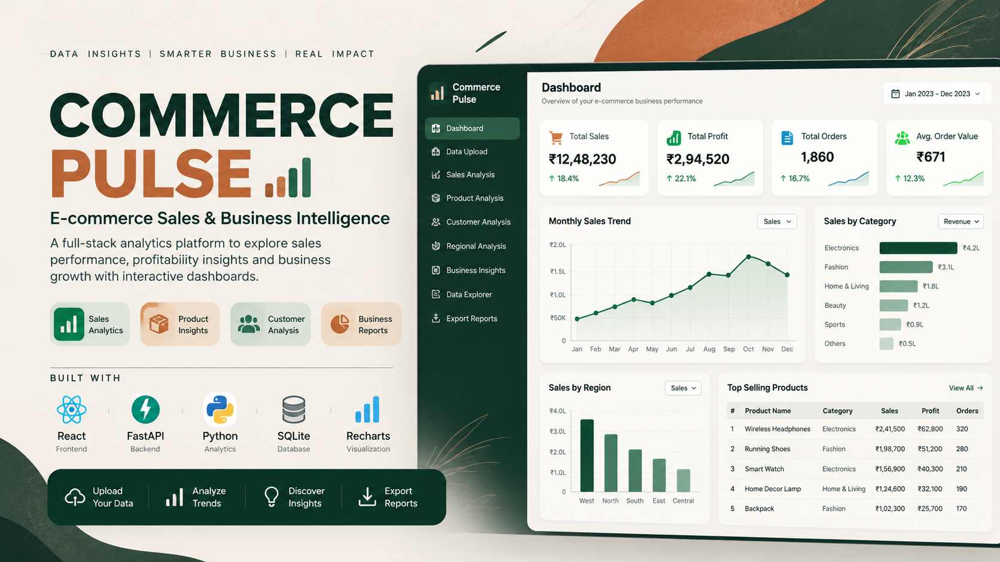

<div align="center">
  
</div>

# Commerce Ledger — Sales & Business Intelligence Workspace

Commerce Ledger is a full-stack portfolio project for **Data Analyst, BI Analyst, and Business Analyst** applications. It combines a React dashboard, a Python/FastAPI API, SQLite persistence, interactive charts, an upload-and-submit workflow, and SQL examples in one repository.

The interface uses a warm paper background, forest-green navigation, quiet borders, compact metrics, clear tables, and restrained chart colours. It is intentionally closer to a practical business workspace than a neon or gradient-heavy AI template.

> **Data honesty:** the built-in dataset is synthetic. It exists to demonstrate the workflow and is not connected to a live store. Uploaded files are saved into this application's SQLite database. During local development, that database lives in `backend/data/commerce.db` and is excluded from Git.

## What the project does

### Overview and business reporting
- Gross sales, net profit (when available), orders, average order value, units and profit margin.
- Monthly sales and profit trend, category revenue mix, regional contribution, and top-product ranking.
- Date, category, region and channel filters.
- Automatically composed descriptive notes to help an analyst frame the next question. The notes do not claim causality or forecasts.
- Export the filtered records or a KPI summary as CSV.

### Upload and submit workflow
1. Open **Import data** in the left navigation.
2. Choose a `.csv`, `.xlsx`, or `.xls` file, or drag it into the file area.
3. Select **Preview columns** to inspect detected headers and the first rows.
4. Check/correct the suggested field mappings.
5. Give the dataset a name, select the currency display, and click **Submit & analyse data**. This explicit submission step is when the file is validated and saved.
6. The new dataset opens in the overview and is also listed in **Data library**.

The import screen shows the selected filename and size, allows replacing/removing the file, displays row previews, explains required columns, and returns inline error messages when the source data cannot be analysed.

### Analysis and operations
- **Sales explorer:** search, sort, paginate, filter, and export order-level rows.
- **Business notes:** descriptive signals and structured questions for a business review.
- **Data library:** switch between datasets or delete imported ones. The built-in demo is protected from accidental deletion.
- CSV/Excel reader with header suggestions and manual mappings.
- Row validation for invalid dates, missing revenue and negative sales values. Invalid rows are skipped and the dropped-row count is retained in dataset metadata.
- If total revenue is missing, it can be derived from quantity × unit price. Profit is calculated from revenue minus cost when both are available; if neither cost nor profit is present, profit is shown as unavailable rather than invented.
- SQL queries for monthly, category, product and regional reporting.
- API health endpoint and interactive API documentation at `/docs`.

## Stack

| Layer | Technology | Purpose |
|---|---|---|
| Frontend | React, Vite, JavaScript | Responsive single-page application and import flow |
| Charts | Recharts | Sales trend, category mix and reporting visualisations |
| UI icons | Lucide React | Consistent navigation and action icons |
| API | FastAPI, Uvicorn | Upload validation, datasets, dashboards, table queries and exports |
| Data processing | pandas | CSV/Excel reading, numeric cleanup, field mapping and aggregation |
| Persistence | SQLAlchemy + SQLite | Dataset catalogue and normalized sales records |
| Testing | pytest + FastAPI TestClient | Data-normalization and API workflow tests |

## Requirements

- Python 3.10 or newer
- Node.js 20 or newer (npm included)
- Internet connection for the first install of Python and npm packages

## Run on macOS or Linux

From the extracted project folder, run:

```bash
chmod +x run_mac_linux.sh
./run_mac_linux.sh
```

The script creates `.venv`, installs the backend dependencies, installs frontend packages if needed, launches the API at `http://127.0.0.1:8000`, then starts the frontend at `http://127.0.0.1:5173` and opens the browser when macOS supports it.

Stop the frontend with **Control + C** in Terminal; the script also stops the API process it started.

## Run on Windows

Double-click `run_windows.bat`. It creates the virtual environment, installs dependencies, starts the API in a separate terminal window, and opens the frontend at `http://127.0.0.1:5173`.

## Run the two services manually

### Backend API

From the repository root:

```bash
python3 -m venv .venv
source .venv/bin/activate             # Windows: .venv\\Scripts\\activate.bat
python -m pip install -r backend/requirements.txt
python -m uvicorn backend.app.main:app --reload --host 127.0.0.1 --port 8000
```

- Health: `http://127.0.0.1:8000/api/health`
- API docs: `http://127.0.0.1:8000/docs`

### Frontend

In a second terminal:

```bash
cd frontend
npm install
npm run dev
```

Then open `http://127.0.0.1:5173`.

If the API runs elsewhere, set `VITE_API_URL` before starting Vite, for example `VITE_API_URL=http://127.0.0.1:8000 npm run dev`.

## Source data requirements

The importer suggests mappings for common names like `Order Date`, `Invoice Date`, `Sales`, `Revenue`, `Amount`, `Qty`, `Units Sold`, `Unit Price`, `Profit`, `COGS`, `Product Line`, `State`, `Region`, `Channel`, and `Transaction ID`. You can change suggestions before submitting.

Minimum fields:
- **Order date**, plus either a **sales/revenue/amount** field, or both **quantity** and **unit price**.

Helpful optional fields:
- Order ID / invoice number — supports unique-order counts.
- Product and category — supports product and category rankings.
- Region/state/country and sales channel — supports mix analysis.
- Profit or cost / COGS — supports margin analysis.
- Customer, discount and quantity — adds useful context.

Accepted upload formats are CSV, XLSX and XLS; the file size limit is 20 MB. Excel imports use the first worksheet. Check the mapping and preview before submitting. For large or confidential files, use an appropriately secured environment and do not commit the SQLite database or exported customer data to a public repository.

## Repository layout

```text
commerce-ledger/
├── backend/
│   ├── app/
│   │   ├── main.py             # FastAPI routes and dashboard aggregation
│   │   ├── models.py           # SQLAlchemy Dataset and SaleRecord models
│   │   ├── db.py               # SQLite engine and session dependency
│   │   └── data_service.py     # File loading, column suggestions and normalization
│   ├── data/                   # Local SQLite database created on first run
│   ├── tests/                  # Data normalization and API upload tests
│   ├── requirements.txt
│   └── requirements-dev.txt
├── frontend/
│   ├── src/
│   │   ├── App.jsx             # Navigation, dashboard, explorer, import and library
│   │   ├── api.js              # API client
│   │   ├── main.jsx
│   │   └── styles.css          # Responsive, custom visual system
│   ├── package.json
│   ├── index.html
│   └── vite.config.js
├── data/demo_sales.csv         # Synthetic starter rows
├── data/sales_upload_template.csv
├── sql/analysis_queries.sql
├── run_mac_linux.sh
├── run_windows.bat
└── README.md
```

## Run tests

From the repository root:

```bash
python -m pip install -r backend/requirements-dev.txt
python -m pytest -q
```

The suite covers demo-column detection, revenue derivation from quantity and unit price, invalid-row handling, API health/dashboard responses, CSV preview and the complete upload → dashboard → records workflow.

Build the frontend production bundle with:

```bash
cd frontend
npm install
npm run build
```

## Deploy online with Render

The root `render.yaml` defines two services from this repository: a FastAPI API (`commerce-pulse-api`) and a React/Vite static frontend (`commerce-pulse-web`).

### Deploy steps
1. Sign in to [Render](https://dashboard.render.com/) and connect/authorize your GitHub account if prompted.
2. Open **New + → Blueprint** (official guide: [Render Blueprints](https://render.com/docs/infrastructure-as-code)).
3. Select `Nishant27203/commerce-pulse`, branch `main`, and apply the Blueprint in `render.yaml`.
4. Wait for both the API and frontend builds to finish. Open the frontend service URL; the API URL is supplied to Vite from Render's `RENDER_EXTERNAL_URL`.
5. If Render gives the frontend a different hostname, update `CORS_ORIGINS` on the API service to include that exact `https://...onrender.com` origin, then redeploy the API.

### Important hosting limits
- Free web services can sleep after inactivity; the first request after sleep may take longer.
- The bundled sample records are synthetic demo data, not live store data.
- The free service's SQLite filesystem may be ephemeral. Uploaded datasets can be lost after a redeploy/restart unless a persistent disk or managed database is configured. Do not upload confidential customer files to a public demo.
- Keep `.env`, secrets, real customer data, exported private data, `.venv/`, `frontend/node_modules/` and the runtime `backend/data/commerce.db` out of Git.

## Resume entry — edit to match what you can explain

**Commerce Ledger — E-commerce Sales & Business Intelligence Workspace | React, FastAPI, Python, pandas, SQLite, SQL, Recharts**

- Built a full-stack sales analytics workspace with a React frontend and FastAPI backend, including a guided CSV/Excel preview, editable column mapping, explicit submit/analyse step, and persistent SQLite datasets.
- Implemented sales KPIs, monthly trend and category/region/channel summaries, searchable and paginated transaction exploration, business-review notes, and filtered CSV exports.
- Added source-data checks, derived revenue/profit calculations when required inputs are available, SQL analysis examples, and API/data-normalization tests.

Only claim the features you can demonstrate live and explain clearly in an interview. The sample data is synthetic and the automatic notes are descriptive—not a forecasting or causality engine.

## Credits and design approach

The visual approach uses a practical analytics workspace pattern: quiet surfaces, a readable table, explicit upload/preview/submit stages and responsive controls. See the project inspiration links:
- [Metabase example dashboards](https://www.metabase.com/dashboards)
- [eCommerce Analytics Dashboard — Behance project by Toby Oscar](https://www.behance.net/gallery/218588359/eCommerce-Analytics-Dashboard)
- [File input UX pattern](https://uxpatterns.dev/patterns/forms/file-input)
- [Data table UX pattern](https://uxpatterns.dev/patterns/data-display/table)
